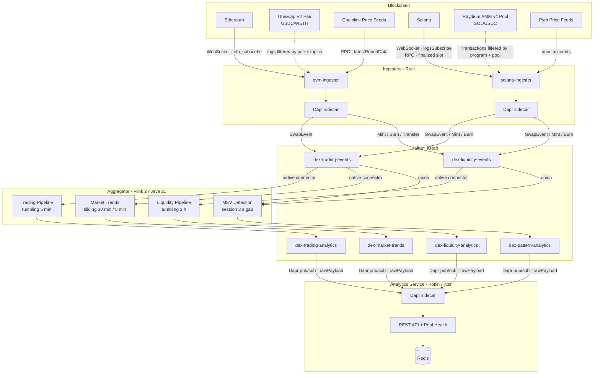
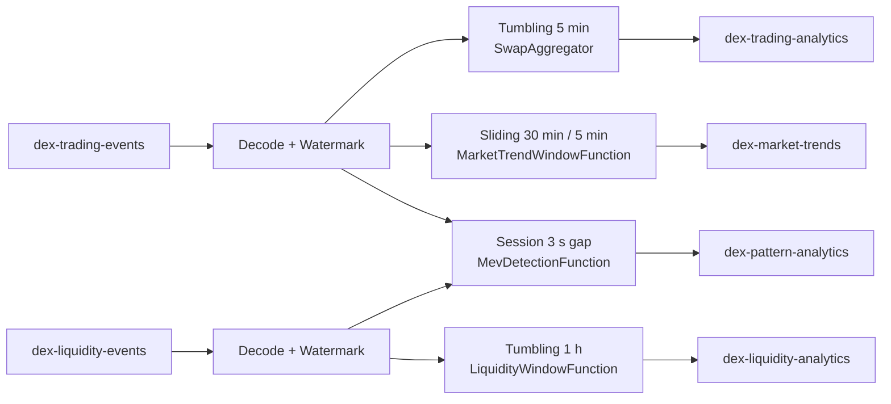

# Architecture

Technical architecture for the DEX Stream Analytics pipeline.

## System Overview

## Event-to-Analytics Mapping

| Input Topic | Event Types | Output Topic | Window | Purpose |
|---|---|---|---|---|
| `dex-trading-events` | SwapEvent | `dex-trading-analytics` | 5-min tumbling | TWAP, OHLC, volume, trader activity |
| `dex-liquidity-events` | Mint + Burn + Transfer | `dex-liquidity-analytics` | 1-hour tumbling | LP flows, TVL changes, churn rate |
| Both topics | All events | `dex-pattern-analytics` | Session (3 s gap) | Sandwich attacks, JIT liquidity |
| `dex-trading-events` | SwapEvent | `dex-market-trends` | 30-min sliding / 5-min slide | Price momentum, volatility, trend direction |

Swap events produce **trading** analytics; Mint/Burn events produce **liquidity** analytics. MEV detection requires cross-event correlation across both topics.

## Design Decisions

### Chain-Agnostic Pool Identity

The domain model treats a chain as an attribute of a pool, not an identity of one. **A pool is
identified by `(chain, pairAddress)`** — a pair address alone is ambiguous, because the same
address can exist on another chain and the same logical market (WETH/USDC) is a *different pool*
on each chain.

Two chain families are implemented: EVM (`evm-ingester`) and Solana (`solana-ingester`).
Pools are declared per chain in `evm.toml` / `solana.toml`, so a single ingester instance serves
all pools on its chain.

The distinction is enforced at three layers, so adding a chain is additive:

| Layer        | Today                                                                |
|--------------|----------------------------------------------------------------------|
| Ingester     | one binary per family; pools, tokens and feeds in that family's TOML |
| Event schema | `chain` (CAIP-2 string) + `chainName` (string) on every event        |
| Flink key    | `(chain, pairAddress)` on all four pipelines                         |

`chain` is CAIP-2 (`eip155:1`, `solana:5eykt...`), not EIP-155's bare numeric chain ID.
EIP-155 can't name a non-EVM cluster, so the chain-neutral form is the only one that works
across both families.

**Why the ingester and not the RPC**: chain identity arrives in the block/slot payload, but a
chain is a deployment fact (which RPC, which pair, which finality model), not an inference.
Reading it from the per-chain config file (alongside the pools, tokens and feeds it must agree with) keeps one code path
per chain family and makes a misconfigured chain a
startup error rather than a mislabelled event.

**Why Solana before another EVM chain**: the aggregator, Avro envelope, Kafka topics, and
analytics service are already chain-neutral; adding Arbitrum or Base would only prove the
seam works within one chain family. Solana forces the two abstractions that actually need
testing — a non-EIP-155 chain identifier and a non-confirmation-count finality model — so it
exercises the design seam, not just an extra deployment.

**Why not more chains today**: each additional family is another ingester binary, another
finality model, and another set of config that must agree with the on-chain reality. The
chain-neutral seam is already proven across two structurally different families; breadth
adds deployments, not evidence. (Ethereum mainnet is monitored today — see `evm.toml`;
mainnet RPC cost is a real constraint at multi-pool scale, which is why the pool list is
curated rather than discovered.)

Events are separated by schema into `dex-trading-events` (SwapEvent only, 7-day retention) and
`dex-liquidity-events` (Mint / Burn / Transfer, 30-day retention). The split buys independent
retention, independent consumer scaling, and a smaller hot topic. It costs cross-stream
ordering: the two topics are consumed separately and unioned for MEV detection, so an event's
position relative to the other stream must be recoverable from the payload. On EVM it is —
`logIndex` is block-global. On Solana it is not: `log_index` is the instruction index *within a
transaction*, so two transactions in the same slot both carry `log_index: 0`. Today that is a
tolerated imprecision because the JIT detector only asserts coincident block ranges, not
interleaving order; an ordering-dependent detector would need a slot-level sequence number in
the schema.

The liquidity topic carries multiple schemas (Mint, Burn, Transfer). The aggregator resolves the correct Avro schema via the CloudEvent `type` header before decode — no shape-guessing.

### Flink Native Kafka (Not Dapr)

The aggregator uses Flink's native Kafka connector for exactly-once semantics (two-phase commit), checkpoint integration, event-time watermarks, and backpressure. Dapr's at-least-once HTTP model cannot provide these guarantees.

Dapr **is** used where its strengths apply: the ingester (decouple from Kafka) and the analytics service (simple subscription model).

**Flink choice rationale**: Selected over Kafka Streams for richer windowing (session windows for MEV detection),
event-time semantics, and exactly-once sink semantics. Kafka Streams would also have worked at this scale; Flink was
chosen because it is the runtime this pipeline is meant to demonstrate, and because its event-time model absorbs the
out-of-order arrival that blockchain finality produces.

### Chainlink Price Oracle

USD volume is computed in the ingester using Chainlink on-chain price feeds with a four-tier fallback: stablecoin shortcut → Chainlink token0 → Chainlink token1 → swap-implied price. Prices are cached with 5-minute TTL; stablecoin lookups are zero-cost.

### Finality Gate

The ingester buffers events for N block confirmations (`confirmations` in `evm.toml`, required; 12 for mainnet) before
publishing. This
prevents reorg artifacts from entering the analytics pipeline. The cost is latency, and it is
not small: at 12-second Ethereum blocks, 12 confirmations is roughly 2.4 minutes before an
event is even published, and the 60-second watermark plus the first window boundary sit on top
of that. Solana finalizes in about 13 seconds, so the two chains do not converge to the same
analytics latency.

### Startup Readiness

Publishing into a sidecar that is not listening yet fails, and the failure path ends in the DLQ:
the per-publish retry budget (three retries, 100 ms initial backoff, ±25 % jitter — roughly
700 ms) is shorter than a cold `daprd` start. Compose ordering alone does not cover this —
`service_started` returns when the container is created, not when daprd can serve HTTP.

So `Publisher::wait_until_ready` polls the sidecar's `/v1.0/healthz` every 250 ms for up to 30 s
before ingestion starts, and the process exits if the sidecar never answers. Neither ingester
exposes a health port: they are push-only producers, so nothing calls into them.

## Component Overview

### evm-ingester (Rust)

Listens to every Uniswap V2 pair declared in `evm.toml` over a single WebSocket subscription (`eth_subscribe` on the
four event topics, filtered by the union of pair addresses). Enriches
each raw log with the block timestamp, transaction gas data, token symbols, and a Chainlink USD
price. Encodes to Avro and publishes via Dapr. A listener task feeds a publisher through a
buffered channel.

Coverage is a config list, not a code path. The pipeline is identical for one pool or twenty; the
pair set is bounded by what the RPC tier sustains, so scaling monitoring is a provider-plan
decision rather than an architectural one.

Named `evm-ingester` (not just `ingester`) because the design is one ingester binary per chain *family*, not per chain:
a second EVM chain reuses this binary with a different `CONFIG_FILE` and RPC URL; Solana is a
different enough execution and account model (no event logs, no EIP-155 chain ID,
commitment-level finality) to need its own ingester, `solana-ingester` — see
[Future Work](#future-work).

**Deployment**: one Docker container per chain, configured through a `CONFIG_FILE` TOML file (`evm.toml`, baked into the
image at build time) for chain, pool, token and oracle data, plus
environment variables for Dapr coordinates, topics, and the RPC URL. The RPC URL stays in env
rather than the config file because it embeds an API key (`ETH_RPC_URL`) and a config file leaked
one before. Adding another EVM chain means another instance with its own `CONFIG_FILE` and env;
the Kafka topics are shared.

**Design note — enrichment happens here, not in Flink**: Chainlink reads and symbol lookups are
cached in the ingester so the values written to the event are frozen at ingest. Flink replay
then re-derives the same numbers deterministically; moving enrichment downstream would make
reprocessing depend on the oracle's later state.

### solana-ingester (Rust)

Subscribes to Raydium AMM v4 transactions over WebSocket (`logsSubscribe`). Solana has no event
logs, so a swap is decoded from the instruction and its fill amounts come from diffing the
transaction's pre/post token balances. USD prices come from Pyth; token symbols from the SPL
token metadata program. A price account's address alone proves nothing — any Pyth receiver
account deserializes — so the oracle also checks that the feed id inside the account is the one
configured for that token, and only accepts fully Wormhole-verified updates. Finality is a
commitment level, not a confirmation count: the ingester
polls the finalized slot over RPC and publishes buffered events once their slot is finalized. It
publishes the same Avro events, CloudEvent envelope and topics as `evm-ingester`, plus a Dapr DLQ
topic (`TOPIC_DLQ`). Chain, programs, tokens and pools come from `solana.toml`; secrets and
runtime scalars from env. See [solana-ingester/README.md](solana-ingester/README.md).

**Design note — one I/O layer, pure transforms beneath it**: a log line travels
`TransactionHandler` → `TransactionFetcher` / `SymbolCache` / `PythOracle` → `EventBuilder`, with
`InstructionProcessor` decoding in between. The handler is the only module that awaits anything:
it fetches the transaction, resolves symbols once per pool, quotes only the sold side of a swap,
and hands the results to the builder. `InstructionProcessor` and `EventBuilder` are pure
functions of their inputs — no RPC, no clock reads inside the event, no hidden oracle call — so
an event's contents are fully determined by the transaction and the prices passed in. This is
what makes enrichment-at-ingest auditable: the numbers a replay reproduces are the numbers the
builder received, not whatever the oracle happened to hold later. Keep new I/O in the handler;
a failure to resolve one instruction's vaults skips that instruction and logs, rather than
dropping the whole transaction.

### stream-aggregator (Flink / Java 21)

Four parallel pipelines reading from two input topics. Decoded and watermarked once per source,
then keyed by `(chain, pairAddress)` — the string `chain + ":" + pairAddress` — for per-pool
partitioning:

Fault tolerance: 60 s bounded-out-of-orderness watermarks, exactly-once delivery from Flink to its
output topics via Kafka transactions. Note the scope: exactly-once holds at the sink boundary only.
Ingest is at-least-once — the ingesters publish over Dapr HTTP with retry, and the aggregator is
idempotent on `eventId` rather than transactional against the source. Late events beyond the
watermark are not currently captured: there is no `allowedLateness` or `sideOutputLateData`
configuration, so an event that arrives more than 60 s behind the watermark is dropped rather
than routed anywhere. The job explicitly configures `exponential-delay` restart (1 s initial backoff, 5 min
max, unlimited attempts) rather than relying on Flink's implicit default — the same values, made
explicit so a future Flink upgrade can't silently change restart behavior again. Per-record
decode/validation failures do not trigger a restart at all: they're caught and routed to a
side-output DLQ stream (see DATA_MODEL.md's Data Quality section) rather than failing the task.

### analytics-service (Kotlin / Ktor)

Subscribes to all four output topics via Dapr push. Stores data in Redis sorted sets (scored by `windowStart` or `detectedAt`). Computes a composite **Pool Health Score** (35 % trading + 35 % liquidity + 30 % safety) and serves query endpoints:

| Group | Endpoints |
|---|---|
| Trading | `/pairs/{pair}/twap`, `/ohlc`, `/volume`, `/trading`, `/latest` |
| Liquidity | `/pairs/{pair}/liquidity`, `/liquidity/latest`, `/liquidity/flows` |
| Pool Health | `/pools/{pair}/health`, `/pools/{pair}/alerts`, `/pools/{pair}/trends`, `/pools/leaderboard` |
| Meta | `/analytics/summary`, `/analytics/pairs`, `/health` |
| Dashboard | `/dashboard` (HTML), `/ws/analytics` (WebSocket live stream) |

## Infrastructure

### Kafka Topics

| Topic                     | Schema(s)                      | Partitions | Retention |
|---------------------------|--------------------------------|------------|-----------|
| `dex-trading-events`      | SwapEvent                      | 6          | 7 d       |
| `dex-liquidity-events`    | Mint / Burn / Transfer         | 6          | 30 d      |
| `dex-dlq-events`          | JSON (failed payload + reason) | 3          | 30 d      |
| `dex-trading-analytics`   | AggregatedAnalytics            | 3          | 30 d      |
| `dex-liquidity-analytics` | LiquidityAnalytics             | 3          | 90 d      |
| `dex-pattern-analytics`   | MevAlert                       | 3          | 30 d      |
| `dex-market-trends`       | MarketTrend                    | 3          | 30 d      |

`dex-dlq-events` is written by both ingesters on publish failure and by nothing else — there is no
consumer, no alerting, and no compaction. Records also publish unkeyed, so they do not preserve the
pool they came from. It is a capture point, not a recovery path; see `GAPS.md`.

Input topics are keyed by `pairAddress`, so all events for a pool land on one partition in order.
Output topics are unkeyed — `buildKafkaSink` sets no key serializer, so records round-robin
across partitions. Anything consuming an output topic must therefore order by the window
timestamp in the payload, not by partition order.

### Docker Compose Services

| Service                     | Purpose                                          | Port          |
|-----------------------------|--------------------------------------------------|---------------|
| kafka                       | KRaft broker                                     | 9092          |
| kafka-init                  | One-shot topic provisioning                      | —             |
| redis                       | Analytics store                                  | 6379          |
| dapr-placement              | Dapr placement                                   | 50006         |
| flink-jobmanager            | Builds and runs the Flink job (application mode) | 8081 (Web UI) |
| flink-taskmanager           | Flink workers                                    | —             |
| analytics-service + sidecar | Kotlin API                                       | 8080          |
| evm-ingester + sidecar      | Rust EVM listener                                | —             |
| solana-ingester + sidecar   | Rust Solana listener                             | —             |

`docker compose up -d` starts the full pipeline, including both ingesters, provided `ETH_RPC_URL` and
`SOLANA_RPC_URL` are set in `.env`; `scripts/produce_test_events.py` can feed synthetic events instead of
pointing at live chain access.

## Production vs Prototype

**Simplified for portfolio**:

- Pools are declared in config — production needs Factory `PairCreated` event subscription for
  automatic multi-pool discovery
- In-memory checkpointing — production needs S3/GCS + RocksDB state backend
- No authentication/rate limiting — production needs JWT auth + WAF
- Basic MEV heuristics — production needs gas cost modeling, multi-hop routing analysis

**Production patterns retained**:

- Exactly-once delivery to Kafka at the Flink sink (two-phase commit + Kafka transactions)
- Event-time processing with watermarks (handles out-of-order blockchain events)
- Finality gate (prevents reorg artifacts)
- Polyglot stack with appropriate language choices per component

## Future Work

**Chain breadth:**

1. **Multi-chain EVM** (Arbitrum, Base): one `evm-ingester` instance per deployment, each with its
   own config file (`[chain]` id, name, confirmations); the aggregator needs no change.

**Beyond chain breadth:**
- **Uniswap V3/V4 support**: V3 keeps `(token0, token1, fee)` pool addressability but replaces
  the constant-product model with tick math; V4 collapses all pools into one `PoolManager`
  singleton, where pool identity is `keccak256(currency0, currency1, fee, tickSpacing, hooks)`
  and hooks can mutate swap amounts. V4 would break the `(chain, pairAddress)` pool identity,
  so it is a real design task, not a version bump.
- **Natural-language query layer**: a read-only compiler from prose to a typed query plan over the
  analytics API. The model selects a query; the engine returns every number.
- **Multi-pool discovery**: subscribe to Factory `PairCreated` instead of declaring pools in TOML
- **Advanced MEV detection**: gas cost modeling, multi-hop routing analysis, cross-pool correlation
- **Observability**: Prometheus metrics, Grafana dashboards, structured logging
- **Production hardening**: Kafka SASL/TLS, Dapr mTLS, secrets management
