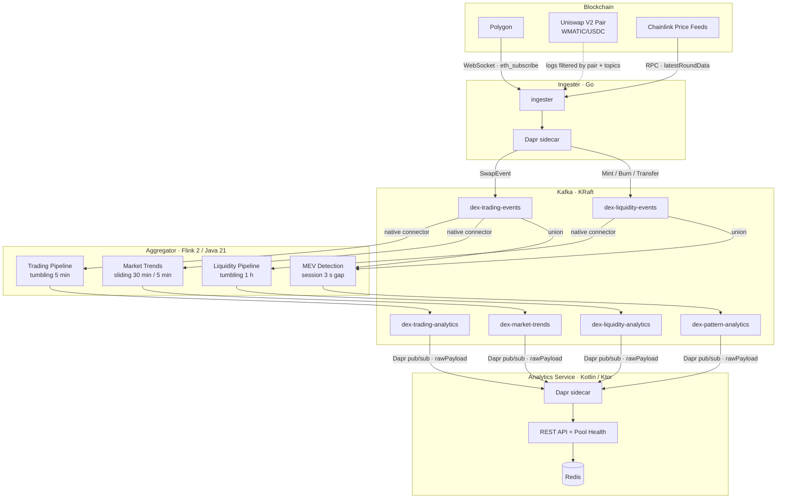
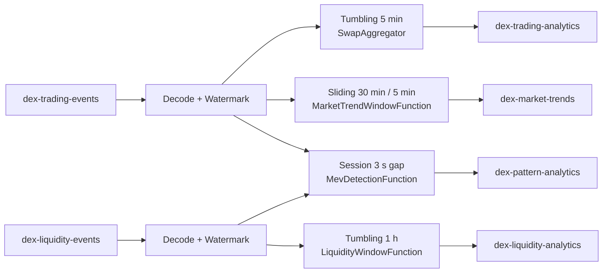

# Architecture

Technical architecture for the DEX Stream Analytics pipeline.

## System Overview

## Event-to-Analytics Mapping

| Input Topic | Event Types | Output Topic | Window | Purpose |
|---|---|---|---|---|
| `dex-trading-events` | SwapEvent | `dex-trading-analytics` | 5-min tumbling | TWAP, OHLC, volume, trader activity |
| `dex-liquidity-events` | Mint + Burn + Transfer | `dex-liquidity-analytics` | 1-hour tumbling | LP flows, TVL changes, churn rate |
| Both topics | All events | `dex-pattern-analytics` | Session (3 s gap) | Sandwich attacks, JIT liquidity |
| `dex-trading-events` | SwapEvent | `dex-market-trends` | 30-min sliding / 5-min slide | Price momentum, volatility, trend direction |

Swap events produce **trading** analytics; Mint/Burn events produce **liquidity** analytics. MEV detection requires cross-event correlation across both topics.

## Design Decisions

### Chain-Agnostic Pool Identity

The pipeline is single-chain today (WMATIC/USDC on Polygon) but the domain model treats a
chain as an attribute of a pool, not an identity of one. **A pool is identified by
`(chain, pairAddress)`** — a pair address alone is ambiguous, because the same address can
exist on another chain and the same logical market (WETH/USDC) is a *different pool* on each
chain.

That distinction is enforced at three places, so adding a chain is additive:

| Layer | Today | Multi-chain |
|---|---|---|
| Ingester | single instance (`evm-ingester`), `PAIR_ADDRESS` | one ingester binary per chain family, `CHAIN` + `CHAIN_NAME` |
| Event schema | no `chain` field | `chain` (CAIP-2 string) + `chainName` (string) on every event |
| Flink key | `pairAddress` | `(chain, pairAddress)` |

`chain` is CAIP-2 (`eip155:137`, `solana:5eykt...`), not EIP-155's bare numeric chain ID —
EIP-155 can't name a non-EVM cluster, so the chain-neutral form is canonical even today,
with only one chain monitored.

**Why the ingester and not the RPC**: chain identity arrives in the block/slot payload, but a
chain is a deployment fact (which RPC, which pair, which finality model), not an inference.
Reading it from env keeps one code path per chain family and makes a misconfigured chain a
startup error rather than a mislabelled event.

**Why Solana next, not another EVM chain**: the aggregator, Avro envelope, Kafka topics, and
analytics service are already chain-neutral; adding Arbitrum or Base would only prove the
seam works within one chain family. Solana forces the two abstractions that actually need
testing — a non-EIP-155 chain identifier and a non-confirmation-count finality model — so it
exercises the design seam, not just an extra deployment.

**Why not Ethereum L1**: mainnet RPC cost for continuous monitoring is prohibitive; L2s give
production-scale data much more cheaply.

Events are separated by frequency into `dex-trading-events` (~100/min) and `dex-liquidity-events` (~10/min). This allows independent consumer scaling, retention policies (7 vs 30 days), and prevents high-frequency swap noise from delaying liquidity consumers.

The liquidity topic carries multiple schemas (Mint, Burn, Transfer). The aggregator resolves the correct Avro schema via the CloudEvent `type` header before decode — no shape-guessing.

### Flink Native Kafka (Not Dapr)

The aggregator uses Flink's native Kafka connector for exactly-once semantics (two-phase commit), checkpoint integration, event-time watermarks, and backpressure. Dapr's at-least-once HTTP model cannot provide these guarantees.

Dapr **is** used where its strengths apply: the ingester (decouple from Kafka) and the analytics service (simple subscription model).

**Flink choice rationale**: Selected over Kafka Streams for richer windowing (session windows for MEV detection), event-time semantics, and exactly-once guarantees. Leverages patterns from REA's Property Passport event pipeline, adapted for blockchain-specific challenges (finality, reorgs, high-frequency MEV patterns).

### Chainlink Price Oracle

USD volume is computed in the ingester using Chainlink on-chain price feeds with a four-tier fallback: stablecoin shortcut → Chainlink token0 → Chainlink token1 → swap-implied price. Prices are cached with 5-minute TTL; stablecoin lookups are zero-cost.

### Finality Gate

The ingester buffers events for N block confirmations (default 64) before publishing. This prevents reorg artifacts from entering the analytics pipeline at the cost of a small latency increase.

## Component Overview

### evm-ingester (Go)

Listens to a single Uniswap V2 pair contract over a WebSocket subscription (`eth_subscribe` on
the four event topics). Enriches each raw log with the block timestamp, transaction gas data,
token symbols, and a Chainlink USD price. Encodes to Avro and publishes via Dapr. One goroutine
listens, one publishes through a buffered channel.

Named `evm-ingester` (not just `ingester`) because the design is one ingester binary per chain
*family*, not per chain: a second EVM chain reuses this binary with a different `RPC_URL` /
`PAIR_ADDRESS`; Solana is a different enough execution and account model (no event logs, no
EIP-155 chain ID, commitment-level finality) to need its own ingester, `solana-ingester` —
see [Future Work](#future-work).

**Deployment**: one Docker container today (the `live` profile), configured by `POLYGON_RPC_URL`
and `PAIR_ADDRESS`. Adding another EVM chain means running the same binary with a different
`RPC_URL`/`PAIR_ADDRESS`/`CHAIN` — the Kafka topics are shared.

**Design note — enrichment happens here, not in Flink**: Chainlink reads and symbol lookups are
cached in the ingester so the values written to the event are frozen at ingest. Flink replay
then re-derives the same numbers deterministically; moving enrichment downstream would make
reprocessing depend on the oracle's later state.

### stream-aggregator (Flink / Java 21)

Four parallel pipelines reading from two input topics. Decoded and watermarked once per source,
then keyed by `pairAddress` (multi-chain: `(chain, pairAddress)`) for per-pool partitioning:

Fault tolerance: 60 s bounded-out-of-orderness watermarks, fixed-delay restart (3 attempts / 10 s), exactly-once delivery via Kafka transactions.

### analytics-service (Kotlin / Ktor)

Subscribes to all four output topics via Dapr push. Stores data in Redis sorted sets (scored by `windowStart` or `detectedAt`). Computes a composite **Pool Health Score** (35 % trading + 35 % liquidity + 30 % safety) and serves query endpoints:

| Group | Endpoints |
|---|---|
| Trading | `/pairs/{pair}/twap`, `/ohlc`, `/volume`, `/trading`, `/latest` |
| Liquidity | `/pairs/{pair}/liquidity`, `/liquidity/latest`, `/liquidity/flows` |
| Pool Health | `/pools/{pair}/health`, `/pools/{pair}/alerts`, `/pools/{pair}/trends`, `/pools/leaderboard` |
| Meta | `/analytics/summary`, `/analytics/pairs`, `/health` |
| Dashboard | `/dashboard` (HTML), `/ws/analytics` (WebSocket live stream) |

## Infrastructure

### Kafka Topics

| Topic | Schema(s) | Partitions | Retention |
|---|---|---|---|
| `dex-trading-events` | SwapEvent | 6 | 7 d |
| `dex-liquidity-events` | Mint / Burn / Transfer | 6 | 30 d |
| `dex-trading-analytics` | AggregatedAnalytics | 3 | 30 d |
| `dex-liquidity-analytics` | LiquidityAnalytics | 3 | 90 d |
| `dex-pattern-analytics` | MevAlert | 3 | 30 d |
| `dex-market-trends` | MarketTrend | 3 | 30 d |

Input topics are keyed by `pairAddress`; output topics by `windowId`.

### Docker Compose Services

| Service | Purpose | Port |
|---|---|---|
| kafka | KRaft broker | 9092 |
| kafka-init | One-shot topic provisioning | — |
| redis | Analytics store | 6379 |
| dapr-placement | Dapr placement | 50006 |
| flink-jobmanager | Builds and runs the Flink job (application mode) | 8081 (Web UI) |
| flink-taskmanager | Flink workers | — |
| analytics-service + sidecar | Kotlin API | 8080 |
| ingester + sidecar (`live` profile) | Go blockchain listener | — |

The default `docker compose up -d` runs the full pipeline without chain access; `scripts/produce_test_events.py` feeds it test events. The `live` profile adds the ingester and requires a Polygon WebSocket RPC endpoint.

## Production vs Prototype

**Simplified for portfolio**:
- Single pair monitoring (WMATIC/USDC) — production needs Factory `PairCreated` event subscription for multi-pool discovery
- In-memory checkpointing — production needs S3/GCS + RocksDB state backend
- No authentication/rate limiting — production needs JWT auth + WAF
- Basic MEV heuristics — production needs gas cost modeling, multi-hop routing analysis

**Production patterns retained**:
- Exactly-once semantics (Flink two-phase commit + Kafka transactions)
- Event-time processing with watermarks (handles out-of-order blockchain events)
- Finality gate (prevents reorg artifacts)
- Polyglot stack with appropriate language choices per component

**Connection to professional experience**: Demonstrates Apache Flink patterns from REA Property Passport NFT pipeline, applied to DeFi challenges (MEV detection, liquidity monitoring, blockchain finality).

## Future Work

**Chain breadth:**
1. **Solana ingester**: a new ingester family (`solana-ingester`), not another instance of
   `evm-ingester`. Solana has no event-log abstraction — a swap is an *instruction* inside a
   transaction, decoded per-program (Raydium AMM v4, a constant-product venue matching Uniswap
   V2's math). Fill amounts are not in the instruction arguments; they come from diffing the
   transaction's `preTokenBalances`/`postTokenBalances`. Kafka, the CloudEvent envelope, Flink,
   and the analytics service are reused unchanged. Requires one schema decision (a chain-neutral
   field set: `chain` namespaced CAIP-2 style rather than EIP-155 numeric, and `gasUsed`/
   `gasPrice` generalised to a fee concept) and one abstraction (finality is a commitment level,
   not an N-confirmation count). Rust, not Go — Solana/Anchor tooling and Raydium's IDL-based
   instruction decoding are Rust-first; Dapr's publish call is plain HTTP, so the Rust Dapr
   SDK's alpha status doesn't factor into this choice.
2. **Multi-chain EVM** (Arbitrum, Base): lower priority than Solana — it adds deployments
   within a chain family the design already generalizes over, rather than testing the seam
   itself. `CHAIN`/`CHAIN_NAME` in `evm-ingester`, one instance each; the aggregator needs only
   the key change — `(chain, pairAddress)`.

**Beyond chain breadth:**
- **Uniswap V3/V4 support**: V3 keeps `(token0, token1, fee)` pool addressability but replaces
  the constant-product model with tick math; V4 collapses all pools into one `PoolManager`
  singleton, where pool identity is `keccak256(currency0, currency1, fee, tickSpacing, hooks)`
  and hooks can mutate swap amounts. V4 would break the `(chain, pairAddress)` pool identity,
  so it is a real design task, not a version bump.
- **Multi-pool discovery**: subscribe to Factory `PairCreated` instead of a hardcoded pair
- **Advanced MEV detection**: gas cost modeling, multi-hop routing analysis
- **Ethereum L1 monitoring**: mainnet support when RPC costs are feasible
- **Observability**: Prometheus metrics, Grafana dashboards, structured logging
- **Production hardening**: Kafka SASL/TLS, Dapr mTLS, secrets management
